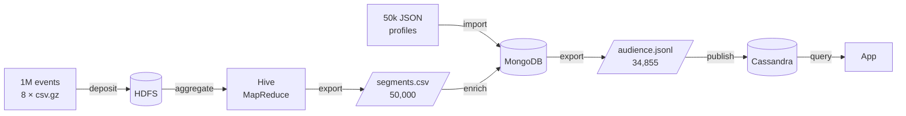

# Polyglot Data Pipeline: Hive → MongoDB → Cassandra

**English** | [Français](#français)

End-to-end, fully reproducible data pipeline that turns **1,000,000 streaming events** into a **low-latency audience service**, using three storage technologies, each for the job it does best:

| Stage | Technology | Role | Output |
|---|---|---|---|
| Batch analytics | **HDFS + Hive** (MapReduce on YARN) | Distributed aggregation of raw events | `segments_utilisateurs.csv`: 50,000 users |
| Operational documents | **MongoDB 8** | Flexible user profiles enriched with analytics | `audience_cible.jsonl`: 34,855 users |
| Serving layer | **Cassandra 5** | Query-first tables, millisecond top-N reads | Tables by (country, segment) and (plan, country) |

> Academic project completed for the **INF6303 (Big Data)** course. The dataset was provided by the course and is not redistributed in this repository.



Detailed architecture, responsibilities and recovery points: [`docs/ARCHITECTURE.md`](docs/ARCHITECTURE.md).

## Highlights

- **Reproducible in one command.** After a full reset (`docker compose down -v`), `run_pipeline.sh` rebuilds everything in about 20 minutes, and both hand-off files are **byte-identical** to the reference run.
- **Verified, not just executed.** Data integrity (SHA-256), volume and quality checks, conservation checks (Σ events = 1,000,000; Σ watch time preserved), and end-to-end lineage of 3 users across 6 checkpoints.
- **13 environment defects diagnosed and fixed** in the provided Docker stack, including:
  - Java 8 / Java 11 mismatch between HiveServer2 and the YARN NodeManager, which broke Kryo plan deserialization (fixed with a custom NodeManager image);
  - a missing `commons-collections` 3 jar in Hadoop 3.4, shipped with `hive.aux.jars.path`;
  - `CombineHiveInputFormat` ignoring CSV headers (2,001 rows instead of 2,000), switched to `HiveInputFormat`, which also gives one mapper per gzip file;
  - unpinned base image (`latest`), now pinned by digest.
- **Query-first modeling.** Cassandra partition key `(country, segment)`, clustering `score DESC`, hot-partition analysis (23× skew) and bucketing strategy.
- **Measured trade-offs.** MongoDB `explain()` shows the compound index reads 131× fewer documents on selective queries, but brings no gain on a query returning 70% of the collection.

## Results

| Check | Value |
|---|---|
| Events / contents / profiles | 1,000,000 / 2,000 / 50,000 |
| Segments (Hive = MongoDB) | active 30,901 · intensive 7,430 · occasional 11,669 |
| Audience exported = rows in Cassandra | 34,855 = 34,855 (16/16 partitions match) |
| Top-10 read (single partition) | ~2–4 ms |
| Filter on non-key column (`ALLOW FILTERING`) | ~87 ms (full scan) |

## Repository structure

```
compose.yaml                 Docker stack (Hadoop, Hive, Jupyter, MongoDB, Cassandra)
docker/                      Notebook image + NodeManager image (Java 8)
hadoop-config/, hive-config/ Hadoop / YARN / Hive configuration
workspace/
  00_deposer_dans_hdfs.sh    Deposit raw files into HDFS
  01_hive_analyse.sql        Part A: external tables, quality, analytics, segmentation
  02_mongodb_enrichissement.py  Part B: import, indexes, enrichment, export
  03_cassandra_publication.py   Part C: query-first tables, prepared inserts, service queries
  05_tracabilite.py          Part D: lineage of 3 users across all systems
  run_pipeline.sh            Full pipeline in one command
  output/                    Hand-off files between systems
  preuves/                   Execution evidence (logs and results)
docs/                        Architecture, report notes, screenshots
```

## Quick start

Requirements: Docker Desktop with **≥ 10 GB RAM**, project in a path **without accents or spaces**, and the course dataset in `data/`.

```powershell
docker compose --profile hadoop --profile nosql up -d --build
```

Then open JupyterLab at <http://localhost:8888/lab?token=inf6303>, open a terminal and run:

```bash
bash /home/jovyan/work/run_pipeline.sh
```

## Tech stack

Hadoop 3.4.3 (HDFS, YARN, MapReduce) · Hive 4.0.0 · MongoDB 8.0 · Cassandra 5.0 · Python 3.13 (pymongo, cassandra-driver) · Docker Compose · JupyterLab

---

## Français

**Pipeline de données polyglotte : Hive → MongoDB → Cassandra.** Projet réalisé dans le cadre du cours **INF6303 (Big Data)**. Les données ont été fournies par le cours et ne sont pas redistribuées dans ce dépôt.

Ce pipeline transforme **1 000 000 d'événements** de visionnage en une **audience consultable à faible latence**, en confiant chaque étape à la technologie la plus adaptée :

| Étape | Technologie | Rôle | Sortie |
|---|---|---|---|
| Analyse massive | **HDFS + Hive** (MapReduce sur YARN) | Agrégation distribuée des événements bruts | `segments_utilisateurs.csv` : 50 000 utilisateurs |
| Document opérationnel | **MongoDB 8** | Profils souples enrichis par l'analyse | `audience_cible.jsonl` : 34 855 utilisateurs |
| Vue de service | **Cassandra 5** | Tables orientées requête, top N en quelques ms | Tables par (pays, segment) et (plan, pays) |

### Points forts
- **Reproductible en une commande** : après une remise à zéro complète (`down -v`), `run_pipeline.sh` reconstruit tout en environ 20 minutes, avec des fichiers de passage **identiques à l'octet près**.
- **Résultats vérifiés** : intégrité SHA-256, contrôles de volume et de qualité, conservation des totaux, traçabilité de 3 utilisateurs sur 6 points de contrôle.
- **13 défauts de l'environnement fourni diagnostiqués et corrigés** : incompatibilité Java 8 / Java 11 entre HiveServer2 et YARN, jar manquant dans Hadoop 3.4, en-têtes CSV ignorés par `CombineHiveInputFormat`, image de base non figée, etc.
- **Modélisation orientée requête** : clé de partition `(country, segment)`, tri `score DESC`, analyse de partition chaude (déséquilibre ×23).
- **Compromis mesurés** : avec `explain()`, l'index composé MongoDB lit 131 fois moins de documents sur une requête sélective, mais n'apporte rien sur une requête qui renvoie 70 % de la collection.

### Démarrage rapide
Prérequis : Docker Desktop avec **au moins 10 Go de RAM**, projet dans un chemin **sans accents ni espaces**, données du cours dans `data/`.

```powershell
docker compose --profile hadoop --profile nosql up -d --build
```

Puis, dans un terminal JupyterLab (<http://localhost:8888/lab?token=inf6303>) :

```bash
bash /home/jovyan/work/run_pipeline.sh
```

Architecture détaillée : [`docs/ARCHITECTURE.md`](docs/ARCHITECTURE.md) · Procédure complète : [`README_EQUIPE.md`](README_EQUIPE.md)

---

**Auteur :** Innocent Sado *(coéquipiers éventuels à ajouter)* · [GitHub](https://github.com/InnocentSADO)