# Architecture du pipeline polyglotte

```mermaid
flowchart LR
  subgraph SRC["Sources fournies"]
    E["evenements/*.csv.gz<br/>1 000 000 lignes, 8 gzip"]
    C["catalogue_contenus.csv<br/>2 000 contenus"]
    P["profils_utilisateurs.jsonl.gz<br/>50 000 profils JSON"]
  end

  subgraph ANA["Stockage analytique : Hadoop"]
    H[("HDFS<br/>/inf6303/devoir1/evenements<br/>/inf6303/devoir1/catalogue")]
    HV["Hive : HiveQL compile en MapReduce sur YARN<br/>tables externes evenements_massifs, catalogue_contenus"]
    HS[("HDFS<br/>/inf6303/devoir1/sorties/segments<br/>table externe segments_utilisateurs")]
  end

  F1[/"output/segments_utilisateurs.csv<br/>50 000 lignes (fichier de passage)"/]

  subgraph DOC["Document opérationnel : MongoDB"]
    M[("inf6303_devoir1.profils<br/>50 000 documents + sous-document analytics<br/>index ux_user_id, ix_segment_consent_country")]
  end

  F2[/"output/audience_cible.jsonl<br/>34 855 lignes (fichier de passage)"/]

  subgraph SRV["Vue de service : Cassandra"]
    K[("audience_par_pays_segment<br/>PK ((country, segment), score, user_id)")]
    K2[("audience_par_plan<br/>PK ((plan, country), score, user_id)")]
  end

  APP["Application / tableau de bord"]

  E -- "déposer (hdfs dfs -put)" --> H
  C -- "déposer (hdfs dfs -put)" --> H
  H -- "agréger (GROUP BY user_id + seuils)" --> HV
  HV -- "INSERT OVERWRITE" --> HS
  HS -- "exporter (hdfs dfs -getmerge)" --> F1
  P -- "importer (insert_many)" --> M
  F1 -- "enrichir ($set analytics par user_id)" --> M
  M -- "exporter (consentants intensif + actif)" --> F2
  F2 -- "publier (INSERT préparé)" --> K
  F2 -- "publier (INSERT préparé)" --> K2
  K -- "interroger (top N par pays et segment)" --> APP
  K2 -- "interroger (top N par plan et pays)" --> APP
```

## Responsabilités des trois systèmes

| Rôle | Système | Ce qu'il fait | Ce qu'il ne fait pas |
|---|---|---|---|
| **Stockage analytique** | HDFS + Hive | Conserve le million d'événements bruts (source de vérité) ; agrégations massives en lots (MapReduce) | Pas d'accès unitaire rapide ni de mise à jour d'un profil |
| **Document opérationnel** | MongoDB | Profil complet et souple par utilisateur (sous-documents, tableaux), enrichi par Hive ; requêtes indexées, filtrage métier (consentement) | Ne stocke pas les événements bruts ; pas conçu pour un top N massif à faible latence par partition |
| **Vue de service** | Cassandra | Réponse en quelques ms à une requête connue (top N par pays et segment), données dénormalisées et pré-triées | Pas de jointure ni de requête ad hoc (filtrer par plan est refusé sans table dédiée) |

## Clé d'interconnexion
`user_id` est conservé sans transformation de bout en bout : clé de regroupement Hive, index unique MongoDB, colonne de clustering Cassandra. Aucun identifiant n'est créé entre les étapes (MongoDB : mises à jour sans upsert).

## Points de reprise en cas d'échec
Chaque frontière entre deux systèmes passe par un **fichier de passage persistant et vérifiable** :
- **Hive → MongoDB : `segments_utilisateurs.csv`** (point de reprise principal). Si MongoDB échoue, on relance seulement `02_mongodb_enrichissement.py`, sans refaire les ~15 minutes de MapReduce. Le fichier est contrôlé avant reprise (`04_validation_pipeline.py`, 50 000 lignes, segments conformes au manifeste).
- **MongoDB → Cassandra : `audience_cible.jsonl`**. Si Cassandra échoue, on relance seulement `03_cassandra_publication.py`.
- Chaque étape est **idempotente** : `INSERT OVERWRITE` (Hive), collection vidée puis réimportée (MongoDB), table recréée et upserts (Cassandra). Une reprise ne crée donc jamais de doublons.